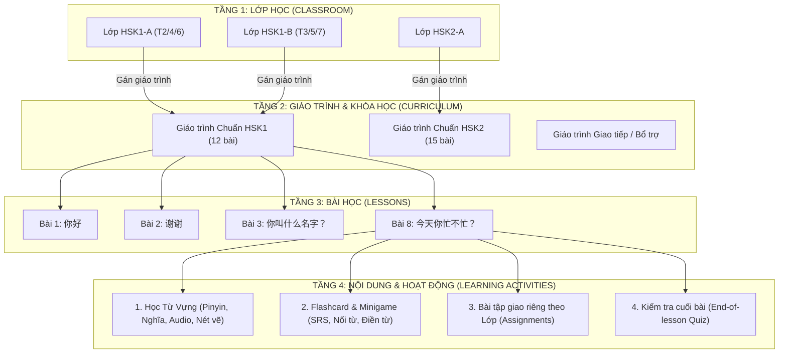
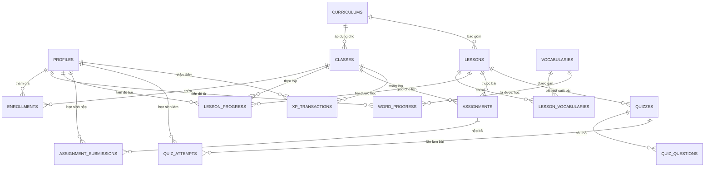
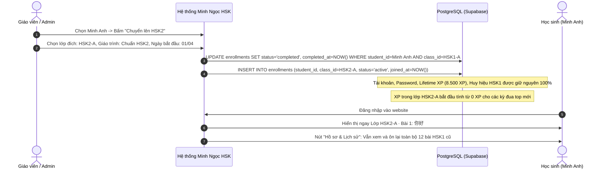

# HỆ THỐNG QUẢN LÝ ĐÀO TẠO & HỌC TẬP MINH NGỌC HSK
## Tài liệu Thiết kế Kiến trúc, Cơ sở Dữ liệu & Wireframe Giao diện 4 Màn hình Trọng tâm

---

## 1. TỔNG QUAN KIẾN TRÚC 4 TẦNG (SYSTEM ARCHITECTURE)

Hệ thống được chuyển đổi từ mô hình học từ vựng đơn lẻ sang mô hình **Quản lý Đào tạo theo Lớp học kết hợp Gamification (LMS + Gamified Chinese Learning)**:



### Các nguyên tắc vàng (Core Principles):
1. **Tài khoản duy nhất (Single Identity)**: Học sinh chỉ có 1 tài khoản duy nhất. Khi lên cấp (HSK1 -> HSK2 -> HSK3), toàn bộ lịch sử học tập, tổng XP trọn đời và huy hiệu được giữ nguyên vẹn.
2. **Lớp học độc lập (Class Isolation)**: 
   - Tiến độ bài học của từng lớp hoàn toàn độc lập (HSK1-A học Bài 8, HSK1-B học Bài 5 dù chung giáo trình HSK1).
   - Học sinh chỉ thấy lớp học hiện tại của mình, không thấy lớp khác.
   - Bảng xếp hạng (Leaderboard) được tính riêng cho từng lớp theo chu kỳ (Hôm nay, Tuần này, Tháng này, Tổng kỳ).
3. **Giáo trình linh hoạt (Dynamic Curriculums)**: Nội dung bài học và từ vựng lưu động trong Database, nhập xuất dễ dàng qua Excel, không bị hardcode trong mã nguồn.
4. **Cơ chế mở bài linh hoạt (Flexible Unlock Mechanism)**:
   - **Chế độ Tuần tự**: Học sinh buộc phải hoàn thành bài trước (đạt >= 80% quiz) mới mở bài sau.
   - **Chế độ Mở toàn bộ**: Cho phép học sinh tự do học trước hoặc ôn tập.
   - **Mở thủ công (Admin Override)**: Giáo viên có thể bấm mở khóa tức thì cho từng bài hoặc nhóm bài cho một lớp cụ thể.

---

## 2. THIẾT KẾ CƠ SỞ DỮ LIỆU ĐẦY ĐỦ (DATABASE SCHEMA & ERD)



### Chi tiết 16 Bảng dữ liệu chuẩn PostgreSQL / Supabase

#### 1. `profiles` (Tài khoản người dùng)
- `id` (uuid, PK, ref `auth.users(id)`)
- `username` (text, unique)
- `display_name` (text)
- `phone` (text, nullable)
- `avatar_url` (text)
- `role` (text: `'admin'` | `'teacher'` | `'student'`)
- `lifetime_xp` (int, default 0 - Điểm kinh nghiệm toàn đời)
- `current_streak` (int, default 0 - Chuỗi ngày học liên tục)
- `last_active_at` (timestamptz)
- `created_at` (timestamptz)

#### 2. `curriculums` (Giáo trình học tập)
- `id` (uuid, PK)
- `title` (text: ví dụ "Giáo trình Chuẩn HSK1", "Boya Sơ cấp 1")
- `code` (text, unique: ví dụ "HSK1_STANDARD")
- `level` (text: "HSK1", "HSK2", "HSK3", "COMMUNICATION")
- `description` (text)
- `thumbnail_url` (text)
- `total_lessons` (int, default 0)
- `is_active` (boolean, default true)
- `created_at` (timestamptz)

#### 3. `classes` (Lớp học)
- `id` (uuid, PK)
- `name` (text: ví dụ "HSK1 - A", "HSK2 - Tối T2/4/6")
- `curriculum_id` (uuid, FK ref `curriculums(id)`)
- `level` (text: "HSK1", "HSK2",...)
- `teacher_id` (uuid, FK ref `profiles(id)`)
- `start_date` (date)
- `end_date` (date, nullable)
- `status` (text: `'ongoing'` [đang học], `'paused'` [tạm dừng], `'completed'` [kết thúc])
- `unlock_mode` (text: `'sequential'` [tuần tự] | `'all_open'` [mở hết])
- `current_lesson_order` (int, default 1 - Bài hiện tại của lớp)
- `created_at` (timestamptz)

#### 4. `enrollments` (Lịch sử & Quan hệ Học sinh - Lớp học)
- `id` (uuid, PK)
- `student_id` (uuid, FK ref `profiles(id)`)
- `class_id` (uuid, FK ref `classes(id)`)
- `status` (text: `'active'` [đang học], `'completed'` [đã hoàn thành khóa], `'transferred'` [đã chuyển lớp])
- `joined_at` (date)
- `completed_at` (date, nullable)
- `note` (text, ví dụ "Lên lớp HSK2 sau khi đỗ HSK1")
- `created_at` (timestamptz)
- *Constraint: 1 học sinh chỉ có 1 `enrollment` trạng thái `'active'` tại một thời điểm (hoặc nhiều nếu học song song 2 lớp).*

#### 5. `lessons` (Bài học trong giáo trình)
- `id` (uuid, PK)
- `curriculum_id` (uuid, FK ref `curriculums(id)`)
- `order_index` (int: 1, 2, 3... thứ tự bài)
- `title_zh` (text: ví dụ "你好", "今天你忙不忙？")
- `title_vi` (text: ví dụ "Chào bạn", "Hôm nay bạn bận không?")
- `description` (text)
- `audio_dialogue_url` (text, file nghe hội thoại mẫu)
- `grammar_notes` (text/markdown)
- `pass_score_percent` (int, default 80 - % điểm để qua bài)
- `reward_xp` (int, default 50 - XP khi hoàn thành bài)
- `created_at` (timestamptz)

#### 6. `vocabularies` (Kho từ vựng tập trung)
- `id` (uuid, PK)
- `hanzi` (text, not null)
- `pinyin` (text, not null)
- `meaning_vi` (text, not null)
- `hsk_level` (int: 1 -> 6)
- `part_of_speech` (text: danh từ, động từ...)
- `audio_url` (text, phát âm mẫu zh-CN)
- `stroke_order_gif` (text, hình ảnh thứ tự nét viết)
- `example_hanzi` (text)
- `example_pinyin` (text)
- `example_vi` (text)
- `created_at` (timestamptz)

#### 7. `lesson_vocabularies` (Bảng liên kết Bài học - Từ vựng)
- `id` (uuid, PK)
- `lesson_id` (uuid, FK ref `lessons(id)`)
- `vocabulary_id` (uuid, FK ref `vocabularies(id)`)
- `sort_order` (int: thứ tự xuất hiện trong bài)
- *Unique constraint: `(lesson_id, vocabulary_id)`*

#### 8. `class_lesson_unlocks` (Cơ chế mở bài theo từng Lớp)
- `id` (uuid, PK)
- `class_id` (uuid, FK ref `classes(id)`)
- `lesson_id` (uuid, FK ref `lessons(id)`)
- `is_unlocked` (boolean, default false - Mở khóa thủ công bởi Admin)
- `unlocked_at` (timestamptz)

#### 9. `lesson_progress` (Tiến độ bài học của từng học sinh)
- `id` (uuid, PK)
- `student_id` (uuid, FK ref `profiles(id)`)
- `class_id` (uuid, FK ref `classes(id)`)
- `lesson_id` (uuid, FK ref `lessons(id)`)
- `words_learned_count` (int, default 0)
- `total_words_count` (int, default 0)
- `is_vocab_completed` (boolean, default false)
- `is_practice_completed` (boolean, default false)
- `is_quiz_passed` (boolean, default false)
- `highest_quiz_score` (int, default 0)
- `is_completed` (boolean, default false)
- `completed_at` (timestamptz, nullable)
- *Unique constraint: `(student_id, class_id, lesson_id)`*

#### 10. `word_progress` (Lịch sử ôn tập từ theo Spaced Repetition)
- `id` (uuid, PK)
- `student_id` (uuid, FK ref `profiles(id)`)
- `vocabulary_id` (uuid, FK ref `vocabularies(id)`)
- `mastery_level` (int, default 0: 0=Mới, 1=Đang học, 2=Quen, 3=Thành thạo)
- `correct_streak` (int, default 0)
- `mistake_count` (int, default 0)
- `last_reviewed_at` (timestamptz)
- `next_review_at` (timestamptz)

#### 11. `assignments` (Bài tập giáo viên giao riêng cho lớp)
- `id` (uuid, PK)
- `class_id` (uuid, FK ref `classes(id)`)
- `lesson_id` (uuid, FK ref `lessons(id)`)
- `title` (text, ví dụ "Học thuộc 20 từ vựng Bài 8 + Làm quiz")
- `due_date` (timestamptz - Hạn chót nộp)
- `reward_xp` (int, default 30)
- `allow_late_submission` (boolean, default true)
- `created_at` (timestamptz)

#### 12. `assignment_submissions` (Trạng thái nộp bài tập của học sinh)
- `id` (uuid, PK)
- `assignment_id` (uuid, FK ref `assignments(id)`)
- `student_id` (uuid, FK ref `profiles(id)`)
- `status` (text: `'not_started'`, `'in_progress'`, `'completed'`, `'late'`)
- `completed_at` (timestamptz, nullable)
- `score` (int, nullable)

#### 13. `quizzes` & `quiz_questions` & `quiz_attempts`
- Lưu cấu trúc câu hỏi (trắc nghiệm Hán tự -> Pinyin, Pinyin -> Nghĩa, Nghe audio chọn nghĩa, Điền khuyết) và lịch sử từng lần làm bài (thời gian làm, số câu đúng/sai, điểm số).

#### 14. `xp_transactions` (Lịch sử biến động điểm - Cơ sở tính Leaderboard)
- `id` (uuid, PK)
- `student_id` (uuid, FK ref `profiles(id)`)
- `class_id` (uuid, FK ref `classes(id)` - Gắn điểm với lớp học tương ứng)
- `amount` (int, ví dụ +10, +50)
- `source_type` (text: `'word_learned'`, `'lesson_completed'`, `'quiz_passed'`, `'daily_streak'`, `'assignment_done'`)
- `description` (text)
- `created_at` (timestamptz, default now())
- *Index tối ưu hóa: `idx_xp_class_period (class_id, created_at, student_id)` -> Giúp câu query tính BXH Hôm nay / Tuần này / Tháng này chạy siêu tốc (< 5ms).*

---

## 3. THIẾT KẾ WIREFRAME 4 TRANG TRỌNG TÂM (UI/UX SPECIFICATION)

### TRANG 1: DASHBOARD HỌC SINH (STUDENT CLASS HOME)
*Địa chỉ: `/dashboard` (Tự động tải theo lớp `active` của học sinh)*

```text
+--------------------------------------------------------------------------------------------------+
|  [Logo] Minh Ngọc HSK           [Trang chủ]   [Giáo trình]   [Bài tập]   [BXH Lớp]   (Avatar Minh Anh)|
+--------------------------------------------------------------------------------------------------+
|                                                                                                  |
|  👋 你好，Minh Anh!                                                                               |
|  Lớp học hiện tại: [ 🏷️ HSK1 - A (Tối T2/T4/T6) ]       [ Xem lịch sử khóa học cũ ▾ ]             |
|                                                                                                  |
|  +--------------------------------------------------------------------------------------------+  |
|  |  KHÓA HỌC ĐANG THEO HỌC: Giáo trình Chuẩn HSK1                                              |  |
|  |  Tiến độ lớp: Đang học Bài 8 / 12 bài                 Tiến độ của bạn: 7/12 bài hoàn thành |  |
|  |  [=========================================-----------------------] 58%                    |  |
|  +--------------------------------------------------------------------------------------------+  |
|                                                                                                  |
|  +------------------------+  +------------------------+  +------------------------------------+  |
|  |  🔥 CHUỖI HỌC          |  |  🏆 HẠNG TRONG LỚP     |  |  ⚡ XP KIẾM TUẦN NÀY               |  |
|  |  8 Ngày liên tục       |  |  Hạng 3 / 18 học sinh  |  |  610 XP (+150 hôm nay)             |  |
|  |  [T2][T3][T4][T5][T6]..|  |  Cách Top 2: 110 XP    |  |  Mục tiêu tuần: 800 XP             |  |
|  +------------------------+  +------------------------+  +------------------------------------+  |
|                                                                                                  |
|  +-------------------------------------------------------+  +---------------------------------+  |
|  |  📖 TIẾP TỤC HỌC                                      |  |  🏆 TOP 3 LỚP HSK1-A (TUẦN NÀY) |  |
|  |                                                       |  |                                 |  |
|  |  Bài 8: 今天你忙不忙？ (Hôm nay bạn bận không?)        |  |  🥇 Minh Anh       850 XP       |  |
|  |  Tiến độ: Đã thuộc 12/20 từ vựng (60%)                |  |  🥈 Hoàng Nam      720 XP       |  |
|  |  [===========================------------------]     |  |  🥉 Bạn (Minh Anh) 610 XP       |  |
|  |                                                       |  |  -----------------------------  |  |
|  |  [ ▶️ Tiếp tục học ngay ]   [ Ôn tập từ khó (5) ]       |  |  [ Xem toàn bộ Bảng xếp hạng ]  |  |
|  +-------------------------------------------------------+  +---------------------------------+  |
|                                                                                                  |
|  +--------------------------------------------------------------------------------------------+  |
|  |  🎯 NHIỆM VỤ & BÀI TẬP ĐƯỢC GIAO                                                           |  |
|  |                                                                                            |  |
|  |  [!] Bài tập Bài 8: Học 20 từ mới + Làm bài kiểm tra       Hạn chót: 22:00 Hôm nay         |  |
|  |      Trạng thái: 🟡 Đang làm dở (Chưa làm bài test)        Thưởng: +50 XP   [ Làm tiếp ]    |  |
|  |                                                                                            |  |
|  |  [v] Ôn tập 15 từ vựng Bài 7                               Hạn chót: Hôm qua               |  |
|  |      Trạng thái: 🟢 Đã hoàn thành                          Thưởng: +30 XP   [ Xem lại ]     |  |
|  +--------------------------------------------------------------------------------------------+  |
+--------------------------------------------------------------------------------------------------+
```

---

### TRANG 2: TRANG GIÁO TRÌNH & BÀI HỌC (CURRICULUM & LESSON FLOW)
*Địa chỉ: `/curriculum` và `/lesson/[id]/study`*

#### 2.1. Bản đồ lộ trình bài học (Curriculum Roadmap)
```text
+--------------------------------------------------------------------------------------------------+
|  <- Quay lại Dashboard          GIÁO TRÌNH CHUẨN HSK1 (LỚP HSK1-A)             Tiến độ: 7/12 bài |
+--------------------------------------------------------------------------------------------------+
|                                                                                                  |
|       (⭐ ⭐ ⭐)                                                                                 |
|       [ BÀI 1: 你好 - Chào bạn ] 🟢 Hoàn thành 100% · 20/20 từ · Điểm Test: 100/100              |
|           |                                                                                      |
|       (⭐ ⭐ ⭐)                                                                                 |
|       [ BÀI 2: 谢谢 - Cảm ơn ]  🟢 Hoàn thành 100% · 18/18 từ · Điểm Test: 95/100               |
|           |                                                                                      |
|       (⭐ ⭐ ☆)                                                                                 |
|       [ BÀI 7: 你家有几口人？ ] 🟢 Hoàn thành 100% · 22/22 từ · Điểm Test: 85/100               |
|           |                                                                                      |
|       (  ĐANG HỌC  )                                                                             |
|  ==>  [ BÀI 8: 今天你忙不忙？] 🟡 Đang học · 12/20 từ (60%) · Chưa làm Quiz                      |
|       +---------------------------------------------------------------------------------+        |
|       | [1. Từ vựng (12/20)] -> [2. Flashcard] -> [3. Luyện tập] -> [4. Kiểm tra Quiz]  |        |
|       |                                                    [ 🚀 VÀO HỌC TIẾP ]          |        |
|       +---------------------------------------------------------------------------------+        |
|           |                                                                                      |
|       [ 🔒 BÀI 9: 我想买一本书 ] ⚪ Chưa mở khóa (Hoàn thành Bài 8 để mở bài này)               |
|           |                                                                                      |
|       [ 🔒 BÀI 10: 我会说汉语 ]  ⚪ Chưa mở khóa                                                  |
|                                                                                                  |
+--------------------------------------------------------------------------------------------------+
```

#### 2.2. Giao diện 4 bước học tập trong bài (Lesson Study Studio)
```text
+--------------------------------------------------------------------------------------------------+
|  [<- Thoát]  Bài 8: 今天你忙不忙？     [1. Học từ] == [2. Luyện tập] -- (3. Kiểm tra) -- (4. Xong)  |
+--------------------------------------------------------------------------------------------------+
|                                                                                                  |
|                                         忙                                                       |
|                                       máng                                                       |
|                                      (Tính từ)                                                   |
|                                                                                                  |
|                                🔊 [Phát âm Bắc Kinh]                                             |
|                                                                                                  |
|                            Ý NGHĨA: Bận rộn, tất bật                                             |
|                                                                                                  |
|  +--------------------------------------------------------------------------------------------+  |
|  |  📝 Câu ví dụ:                                                                             |  |
|  |  今天我很忙，你呢？                                                                          |  |
|  |  Jīntiān wǒ hěn máng, nǐ ne?                                                               |  |
|  |  Hôm nay tôi rất bận, còn bạn thì sao?             🔊 [Nghe câu mẫu]                       |  |
|  +--------------------------------------------------------------------------------------------+  |
|                                                                                                  |
|  +------------------------------------+  +----------------------------------------------------+  |
|  |  ✍️ Thứ tự nét viết (Stroke Order) |  |  💡 Mẹo ghi nhớ:                                   |  |
|  |  [ Ảnh động minh họa 3 nét: 忄+ 亡 ]|  |  Bộ Tâm đứng (忄) + chữ Vong (亡) = Bận đến mất tim|  |
|  +------------------------------------+  +----------------------------------------------------+  |
|                                                                                                  |
|            [ ⬅️ Từ trước (Từ 11/20) ]                   [ ➡️ Từ tiếp theo (Từ 13/20) ]            |
|                                                                                                  |
+--------------------------------------------------------------------------------------------------+
```

---

### TRANG 3: BẢNG XẾP HẠNG RIÊNG CỦA LỚP (CLASS LEADERBOARD)
*Địa chỉ: `/leaderboard`*

```text
+--------------------------------------------------------------------------------------------------+
|  BẢNG VÀNG THÀNH TÍCH · LỚP HSK1 - A                                           Sĩ số: 18 học sinh |
|  *Điểm xếp hạng được tính dựa trên số từ học và bài tập hoàn thành trong lớp HSK1-A*             |
+--------------------------------------------------------------------------------------------------+
|                                                                                                  |
|      [ Hôm nay ]             [ 🥈 TUẦN NÀY (Đang chọn) ]             [ Tháng này ]   [ Tổng kỳ ] |
|                                                                                                  |
|                            🏆 TOP 3 CHIẾN THẦN TUẦN NÀY 🏆                                      |
|                                                                                                  |
|             🥈 HẠNG 2                    🥇 HẠNG 1                    🥉 HẠNG 3                  |
|          [Avatar Hoàng Nam]           [Avatar Minh Anh]            [Avatar Thu Hà]               |
|             Hoàng Nam                    Minh Anh                      Thu Hà                    |
|              720 XP                       850 XP                       610 XP                    |
|           5 bài xong                   Học 120 từ                   Streak 7 ngày                |
|                                                                                                  |
|  +--------------------------------------------------------------------------------------------+  |
|  |  👉 VỊ TRÍ CỦA BẠN: Hạng 3 · 610 XP · 4 bài hoàn thành · Cách Hạng Nhì 110 XP [Đua top ngay]|  |
|  +--------------------------------------------------------------------------------------------+  |
|                                                                                                  |
|  DANH SÁCH BẢNG XẾP HẠNG LỚP HSK1-A:                                                             |
|  +------+-------------------+---------+--------------------+---------------+------------------+  |
|  | Hạng | Học sinh          | XP Tuần | Số từ đã học tuần  | Bài hoàn thành| Chuỗi Streak     |  |
|  +------+-------------------+---------+--------------------+---------------+------------------+  |
|  |  1   | Minh Anh 👑       | 850 XP  | 120 từ             | 5 bài         | 🔥 12 ngày       |  |
|  |  2   | Hoàng Nam 🥈      | 720 XP  | 95 từ              | 5 bài         | 🔥 8 ngày        |  |
|  |  3   | Bạn (Thu Hà) 🥉   | 610 XP  | 85 từ              | 4 bài         | 🔥 7 ngày        |  |
|  |  4   | Gia Bảo           | 550 XP  | 70 từ              | 3 bài         | 🔥 5 ngày        |  |
|  |  5   | Lan Chi           | 430 XP  | 60 từ              | 3 bài         | 🔥 4 ngày        |  |
|  |  6   | Đức Thắng         | 380 XP  | 50 từ              | 2 bài         | ⚪ 0 ngày        |  |
|  | ...  | ...               | ...     | ...                | ...           | ...              |  |
|  +------+-------------------+---------+--------------------+---------------+------------------+  |
|                                                                                                  |
|  * Khi bấm vào học sinh bất kỳ: Xem Pop-up thành tích công khai (Avatar, Tên, Huy hiệu, Tổng từ). |
|  * Tuyệt đối không hiển thị mật khẩu, số điện thoại, điểm sai cá nhân.                           |
+--------------------------------------------------------------------------------------------------+
```

---

### TRANG 4: ADMIN QUẢN LÝ LỚP HỌC (ADMIN CLASS MANAGEMENT & ANALYTICS)
*Địa chỉ: `/admin/classes` và `/admin/classes/[id]`*

#### 4.1. Danh sách lớp học trung tâm
```text
+--------------------------------------------------------------------------------------------------+
|  ADMIN PORTAL           [Quản lý Lớp]   [Quản lý Giáo trình]   [Kho Từ vựng]   [Học viên]         |
+--------------------------------------------------------------------------------------------------+
|                                                                                                  |
|  QUẢN LÝ LỚP HỌC                                                  [ ➕ Tạo Lớp Học Mới ]          |
|                                                                                                  |
|  +-------------------------+  +-------------------------+  +----------------------------------+  |
|  |  LỚP HSK1 - A           |  |  LỚP HSK1 - B           |  |  LỚP HSK2 - A                    |  |
|  |  Giáo trình: Chuẩn HSK1 |  |  Giáo trình: Chuẩn HSK1 |  |  Giáo trình: Chuẩn HSK2          |  |
|  |  Sĩ số: 18 học sinh     |  |  Sĩ số: 12 học sinh     |  |  Sĩ số: 15 học sinh              |  |
|  |  📍 Đang học: BÀI 8     |  |  📍 Đang học: BÀI 5     |  |  📍 Đang học: BÀI 12             |  |
|  |  Tỷ lệ xong bài: 78%    |  |  Tỷ lệ xong bài: 65%    |  |  Tỷ lệ xong bài: 82%             |  |
|  |  Trạng thái: 🟢 Đang học|  |  Trạng thái: 🟢 Đang học|  |  Trạng thái: 🟢 Đang học         |  |
|  |  [ ⚙️ Quản lý chi tiết ]|  |  [ ⚙️ Quản lý chi tiết ]|  |  [ ⚙️ Quản lý chi tiết ]         |  |
|  +-------------------------+  +-------------------------+  +----------------------------------+  |
+--------------------------------------------------------------------------------------------------+
```

#### 4.2. Trang Quản lý Chi tiết 1 Lớp (Ví dụ Lớp HSK1-A)
```text
+--------------------------------------------------------------------------------------------------+
|  <- Quay lại Danh sách lớp      LỚP HSK1 - A (Khai giảng: 01/10/2026 - T2/4/6)    [ Đang học 🟢 ] |
+--------------------------------------------------------------------------------------------------+
|  [Tab 1: Tổng quan]  [Tab 2: Học sinh (18)]  [Tab 3: Giáo trình]  [Tab 4: Bài tập]  [Tab 5: BXH] |
+--------------------------------------------------------------------------------------------------+
|                                                                                                  |
|  THỐNG KÊ LỚP HỌC HSK1-A:                                                                        |
|  +--------------------+  +--------------------+  +--------------------+  +--------------------+  |
|  |  18                |  |  15                |  |  78%               |  |  84.5 / 100        |  |
|  |  Tổng số học sinh  |  |  Học hôm nay       |  |  Đã xong Bài 8     |  |  Điểm Quiz TB lớp  |  |
|  +--------------------+  +--------------------+  +--------------------+  +--------------------+  |
|                                                                                                  |
|  ⚠️ CẢNH BÁO CẦN CHÚ Ý:                                                                          |
|  - Có 2 học sinh không đăng nhập học 3+ ngày: [Nguyễn Văn C], [Trần Thị D]    [ Gửi thông báo ]   |
|  - Có 3 học sinh chưa hoàn thành bài tập Bài 8 trước 22:00 hôm nay.          [ Nhắc nhở qua Zalo]|
|                                                                                                  |
|  DANH SÁCH HỌC SINH & ĐIỀU PHỐI KHÓA HỌC:         [ ➕ Thêm học sinh ]   [ 🔄 Chuyển lớp hàng loạt ]|
|  +--------------------+------------+--------------+---------------+---------------------------+  |
|  | Học sinh           | Bài đã học | Điểm Quiz TB | Trạng thái    | Thao tác                  |  |
|  +--------------------+------------+--------------+---------------+---------------------------+  |
|  | Minh Anh           | 8/12 bài   | 92 / 100     | 🟢 Chăm chỉ   | [ Chi tiết ] [ ⬆️ Lên HSK2 ]|  |
|  | Hoàng Nam          | 8/12 bài   | 88 / 100     | 🟢 Chăm chỉ   | [ Chi tiết ] [ ⬆️ Lên HSK2 ]|  |
|  | Nguyễn Văn C       | 5/12 bài   | 62 / 100     | 🔴 Nghỉ 3 ngày| [ Chi tiết ] [ Đổi lớp ]   |  |
|  +--------------------+------------+--------------+---------------+---------------------------+  |
|                                                                                                  |
|  TIẾN ĐỘ BÀI HỌC CỦA LỚP:                                                                        |
|  Chế độ mở bài: (o) Tuần tự từng bài       ( ) Mở toàn bộ bài cho lớp                            |
|  Bài 1 - 7: [Đã mở]  |  Bài 8 (Hiện tại): [Đang mở]  |  Bài 9 - 12: [🔒 Đang khóa]              |
|  => [ 🔓 Mở khóa thủ công Bài 9 để lớp ôn tập trước ]                                             |
+--------------------------------------------------------------------------------------------------+
```

---

## 4. QUY TRÌNH HỌC SINH LÊN CẤP HSK2 (STUDENT PROMOTION FLOW)

Quy trình giải quyết triệt để bài toán: **Không tạo tài khoản mới, không xóa dữ liệu cũ, bảo lưu lịch sử học tập trọn đời**:



---

## 5. ĐỀ XUẤT STACK CÔNG NGHỆ TRIỂN KHAI

Để đảm bảo hiệu năng cao, bảo mật nhiều lớp và giao diện chuẩn App hiện đại:
1. **Frontend**: Next.js 15 (App Router) + React 19 + TypeScript + Tailwind CSS.
2. **UI Component System**: Shadcn/UI + Lucide Icons + Framer Motion (hiệu ứng mượt mà cho Flashcard và Gamification).
3. **Backend & Database**: Supabase (PostgreSQL 16) + Row Level Security (RLS) bảo vệ từng lớp học.
4. **Phát âm tiếng Trung (Audio)**: Tích hợp Web Speech API (`zh-CN`) + hỗ trợ CDN lưu file audio MP3 hội thoại bản ngữ.
5. **Thư viện Hán tự**: `hanzi-writer` (hiển thị mô phỏng thứ tự nét viết động đẹp mắt).
